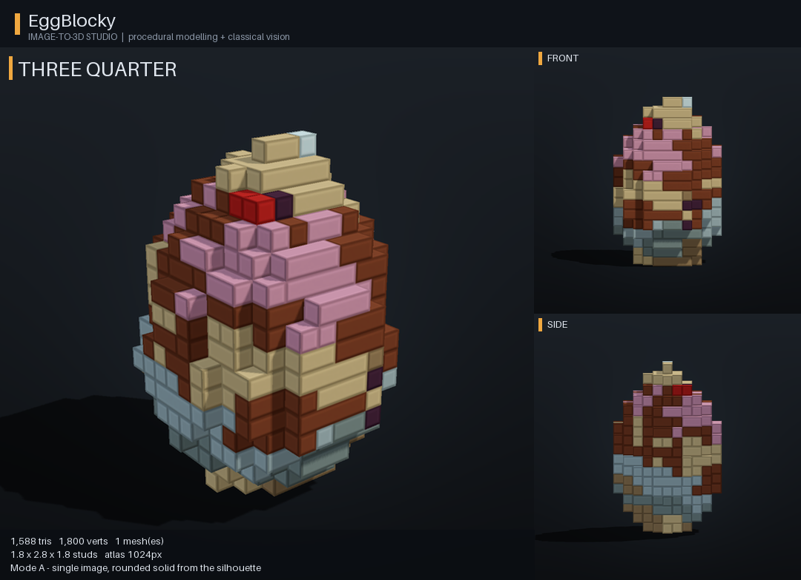
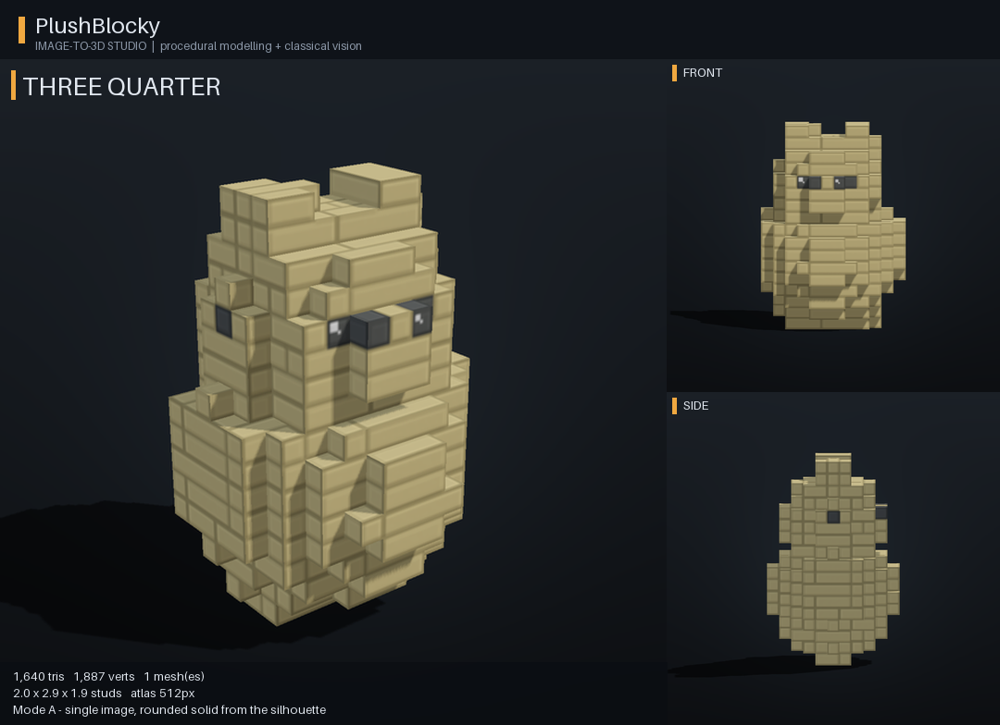
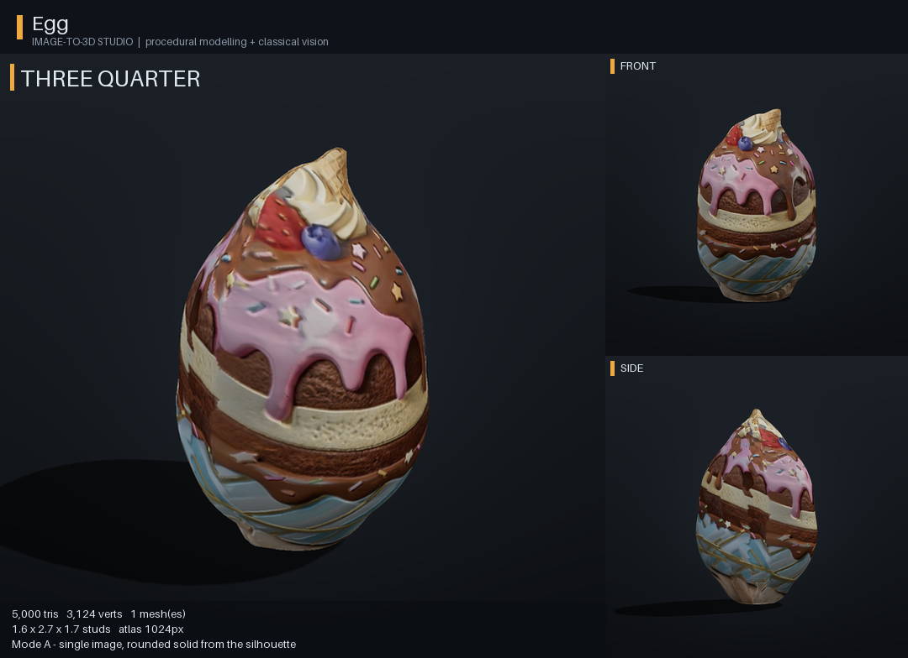
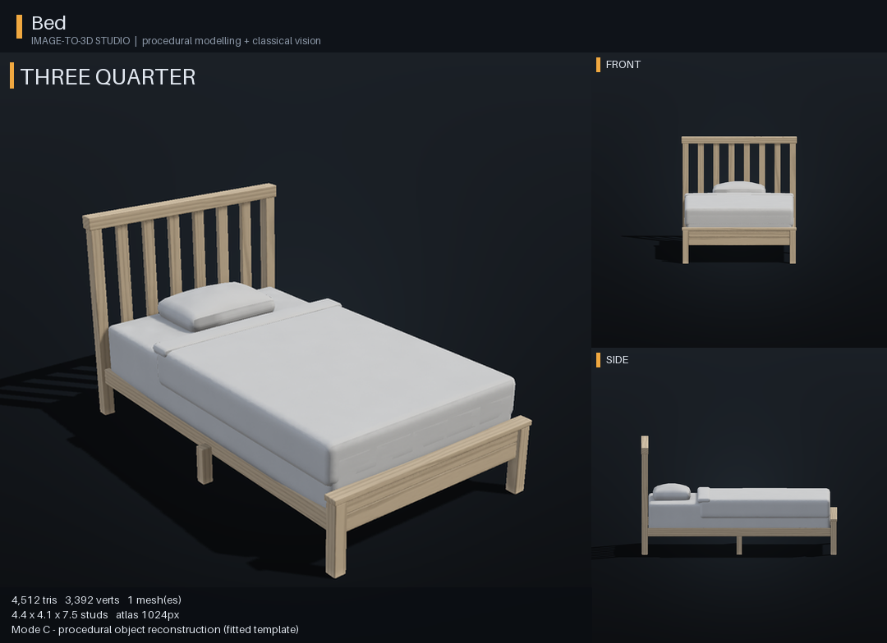

# Sample packages

Real outputs of the bot for the test inputs in `assets/test_images/`, made by
`tools/quality_report.py` with the default settings shown. Each ZIP is exactly
what `/3d create` delivers: FBX with embedded textures, separate texture maps,
GLB, native-part RBXM/RBXMX, metadata, previews, a 3D viewer page and a README.
Measured numbers are in [../docs/TEST_REPORT.md](../docs/TEST_REPORT.md).

| Sample | Input | Strategy | Triangles | Package | Preview |
|---|---|---|---|---|---|
| Bed | bed_photo.jpg | template (bed) | 4,512 | [Bed_v1.zip](Bed_v1.zip) | [preview](previews/Bed.png) |
| Chair | chair_render.png | template (chair) | 3,900 | [Chair_v1.zip](Chair_v1.zip) | [preview](previews/Chair.png) |
| Table | table_render.png | template (table) | 972 | [Table_v1.zip](Table_v1.zip) | [preview](previews/Table.png) |
| Vase | vase_render.png | revolve, synthesised back | 2,852 | [Vase_v1.zip](Vase_v1.zip) | [preview](previews/Vase.png) |
| Egg | egg_photo.jpg | inflate, realistic, symmetric body | 5,000 | [Egg_v1.zip](Egg_v1.zip) | [preview](previews/Egg.png) |
| EggBlocky | egg_photo.jpg | inflate, blocky style | 1,588 | [EggBlocky_v1.zip](EggBlocky_v1.zip) | [preview](previews/EggBlocky.png) |
| EggCartoon | egg_photo.jpg | inflate, cartoon style | 5,000 | [EggCartoon_v1.zip](EggCartoon_v1.zip) | [preview](previews/EggCartoon.png) |
| PlushBlocky | plush_render.png | inflate, blocky style, eyes with highlights | 1,640 | [PlushBlocky_v1.zip](PlushBlocky_v1.zip) | [preview](previews/PlushBlocky.png) |
| MugBlocky | mug_synthetic.jpg | inflate, blocky style, handle hole | 2,340 | [MugBlocky_v1.zip](MugBlocky_v1.zip) | [preview](previews/MugBlocky.png) |
| Donut | donut_synthetic.jpg | inflate with hole | 5,000 | [Donut_v1.zip](Donut_v1.zip) | [preview](previews/Donut.png) |
| MugPhoto | mug_synthetic.jpg | inflate with handle hole | 5,000 | [MugPhoto_v1.zip](MugPhoto_v1.zip) | [preview](previews/MugPhoto.png) |
| Plush | plush_render.png | inflate | 5,000 | [Plush_v1.zip](Plush_v1.zip) | [preview](previews/Plush.png) |
| Emblem | emblem_drawing.png | extrude | 1,960 | [Emblem_v1.zip](Emblem_v1.zip) | [preview](previews/Emblem.png) |
| Mug | 4 images | visual_hull | 4,000 | [Mug_v1.zip](Mug_v1.zip) | [preview](previews/Mug.png) |
| ChairScan | 8 images | turntable | 4,000 | [ChairScan_v1.zip](ChairScan_v1.zip) | [preview](previews/ChairScan.png) |

